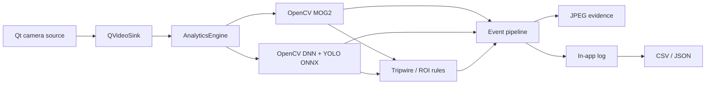

# Sentinel Vision

[](https://isocpp.org/)
[](https://www.qt.io/)
[](https://opencv.org/)
[](https://github.com/ahmedr1zwan/QtCameraApp/actions/workflows/ci.yml)

A native, multi-camera monitoring application that combines classical computer vision with neural-network inference. Sentinel Vision processes Qt video frames through OpenCV motion analysis and an optional YOLO ONNX model, then evaluates activity against operator-drawn tripwires and regions of interest.

Every alert follows the same evidence pipeline: capture a timestamped frame, add it to the in-app event feed, and export the audit trail as CSV or JSON.

## What it demonstrates

- **Hybrid video analytics** — MOG2 background subtraction for inexpensive motion screening plus YOLOv5/YOLOv8 inference through OpenCV DNN.
- **Spatial rules** — draw tripwires and polygonal regions directly over each camera; normalized coordinates keep rules independent of display resolution.
- **Evidence-backed alerts** — motion, object, tripwire, and ROI events trigger snapshots and retain the evidence path in the event record.
- **Multi-camera desktop UI** — four simultaneous Qt Multimedia capture sessions, per-camera controls, full-screen monitoring, and camera configuration.
- **Operational outputs** — bounded in-memory event history with correctly escaped CSV and structured JSON exports.
- **Engineering guardrails** — CMake build, focused Qt Test coverage, and a Linux CI workflow.

## Architecture



`AnalyticsEngine` owns frame conversion, motion segmentation, inference throttling, YOLO output decoding, non-maximum suppression, and normalized detections. QML remains responsible for presentation and interaction; `TripwireManager` owns geometry and cooldown state; `AlertManager` owns the event model and serialization.

## Build

### Requirements

- CMake 3.16+
- A C++17 compiler
- Qt 6 with Quick, Quick Controls 2, and Multimedia
- OpenCV 4.5+ with `core`, `dnn`, `imgproc`, and `video`

On macOS with Homebrew:

```bash
brew install cmake qt qtmultimedia opencv
cmake -S . -B build -DCMAKE_PREFIX_PATH="$(brew --prefix qt);$(brew --prefix opencv)"
cmake --build build --parallel
open build/appQtCameraApp.app
```

On Ubuntu:

```bash
sudo apt-get install cmake g++ qt6-base-dev qt6-declarative-dev \
  qt6-multimedia-dev libopencv-dev
cmake -S . -B build
cmake --build build --parallel
./build/appQtCameraApp
```

Run the test suite with:

```bash
cmake -S . -B build -DBUILD_TESTING=ON
cmake --build build --parallel
ctest --test-dir build --output-on-failure
```

## Configure object detection

The app accepts YOLOv5 and YOLOv8 ONNX exports with a 640 × 640 input. Models stay outside the repository so deployments can choose the size, classes, and license appropriate to their environment.

One way to create a compatible model is:

```bash
python -m pip install ultralytics
yolo export model=yolov8n.pt format=onnx imgsz=640 opset=12
```

Open **Analytics**, select the resulting `.onnx` file, set the confidence threshold, and click **Apply**. The **YOLO** control on each active camera enables inference for that stream. COCO class labels are bundled; custom models can use the same engine with a matching newline-delimited labels file.

## Operator workflow

1. Add a local camera to an empty tile and start the stream.
2. Enable motion analysis, YOLO inference, or both.
3. Select the tripwire or ROI tool and draw directly on the video. Press `Esc` to leave drawing mode.
4. Review alerts from the top bar. Each event includes its source camera, type, description, time, and snapshot path.
5. Export the current event history to CSV or JSON.

Example JSON event:

```json
{
  "timestamp": "2026-10-20T12:04:31-04:00",
  "cameraName": "Front entrance",
  "cameraId": "camera-1",
  "alertType": "object",
  "description": "person detected (91%)",
  "snapshotPath": "/Users/operator/Documents/QtCameraApp/Snapshots/front_entrance_object.jpg"
}
```

## Repository map

| Area | Responsibility |
| --- | --- |
| `analyticsengine.*` | OpenCV motion analysis and YOLO inference |
| `tripwiremanager.*` | Line intersection, point-in-polygon, and rule state |
| `alertmanager.*` | Qt event model and CSV/JSON serialization |
| `CameraTile.qml` | Per-camera capture, controls, overlays, and evidence routing |
| `DetectionOverlay.qml` | Bounding-box and confidence rendering |
| `TripwireOverlay.qml` | Interactive tripwire/ROI authoring |
| `tests/` | Geometry and export regression tests |

## Design decisions

- Detection coordinates are normalized to `[0, 1]`, separating analytics from UI size and aspect ratio.
- YOLO inference is rate-limited independently from motion processing to keep the interface responsive on CPU-only systems.
- MOG2 uses a warm-up window and morphological filtering to reduce startup and sensor-noise alerts.
- Event capture is asynchronous. The alert is committed after `ImageCapture` returns, ensuring the stored path points to an actual saved frame.
- Model files are runtime configuration rather than source assets, keeping clones small and avoiding accidental redistribution of model weights.

## Contributing

Small, focused pull requests are welcome. Please build the app and run `ctest --test-dir build --output-on-failure` before opening a PR. See [CONTRIBUTING.md](CONTRIBUTING.md) for conventions.
